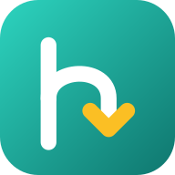

<p align="center">
  
</p>

# hadiGET

Telefonla bilgisayar arasında dosya aktarmanın en kısa yolu. Ücretsiz, açık kaynak, **hesap yok, sunucu yok, yükleme yok**: dosyalar iki cihaz arasında doğrudan (WebRTC) akar.

Tarayıcıda çalışan bir PWA'dır; kurulum gerekmez, ana ekrana eklenir. İlk açılıştan sonra internet olmadan da çalışır.

*English: hadiGET is a serverless, open-source PWA for sending files between your phone and computer over WebRTC. Pairing is done by scanning two QR codes (or copy-pasting two short codes). No backend, no account, nothing is uploaded.*

Geliştirici: [Özgüler Forge](https://ozgulerforge.com.tr) · İletişim: [iletisim@ozgulerforge.com.tr](mailto:iletisim@ozgulerforge.com.tr)

## Nasıl kullanılır

1. İki cihazı **aynı Wi-Fi**'a bağla, hadiGET'i ikisinde de aç.
2. Bir cihazda **Bağlantı başlat**'a bas, ekrana QR kod gelir.
3. Diğer cihazda **Bağlantıya katıl**'ı seç ve o QR kodu okut. Telefonsa kamera uygulamasıyla okutman yeter; uygulama kendiliğinden açılır.
4. Katılan cihaz bir **cevap QR kodu** gösterir. Başlatan cihazda **Cevap QR kodunu kamerayla oku**'ya basıp onu okut. Okuyamıyorsa kodu kopyalayıp başlatan cihazda yapıştır.
5. Bağlandınız. Dosya seç ya da sürükle bırak; kısa metin ve bağlantı da gönderebilirsin. Gelen dosyada **Kaydet**'e bas.

Ayrıntılı kılavuz, ana ekrana ekleme adımları ve sorun giderme tablosu uygulamanın içinde: [`nasil-kullanilir.html`](nasil-kullanilir.html).

## Gizlilik ve yasal metinler

- Dosyalar hiçbir sunucuya yüklenmez; iki cihaz arasında şifreli (DTLS) bir kanaldan geçer.
- Eşleşme için ortada sunucu yoktur; bilgi QR kodlarla elden ele taşınır.
- Hesap, reklam, analiz ya da izleme aracı yoktur.
- Varsayılan olarak sayfa yüklendikten sonra **hiçbir dış hizmete** başvurulmaz. Yalnızca "Farklı ağlardayız" kutusunu işaretlersen, genel adresini öğrenmek için Google'ın STUN sunucusuna (`stun.l.google.com`) küçük bir istek gider; dosya içeriği oraya gitmez.

Metinler uygulamanın içinde, Türkçe ve İngilizce: [`gizlilik.html`](gizlilik.html) (Gizlilik Politikası ve KVKK Aydınlatma Metni), [`kosullar.html`](kosullar.html) (Kullanım Koşulları).

> Bu metinler genel bir şablon değil, uygulamanın gerçek davranışına göre yazıldı; yine de yayına almadan önce bir hukukçuya gösterilmesi önerilir. Yayın yerini (barındırma hizmeti) değiştirirsen `gizlilik.html` içindeki "Barındırma hizmeti" maddesini güncelle.

## Sınırlar (dürüst liste)

- **Aynı ağ gerekir.** Varsayılan kipte iki cihaz aynı Wi-Fi'da (ya da telefonun hotspot'unda) olmalı. Misafir Wi-Fi'ları cihazları birbirinden yalıtabilir. Farklı ağlar için STUN seçeneği çoğu evde çalışır; bazı kurumsal/operatör ağlarında (simetrik NAT) çalışmaz, çünkü aktarma (TURN) sunucusu bilerek yok.
- **Kamerayla QR okuma tarayıcıya bağlıdır.** Tarayıcının yerleşik `BarcodeDetector`'ı varsa kullanılır (Android Chrome, macOS Chrome gibi). Windows/Linux'taki Chrome ve Firefox'ta yoktur; orada iki yol var:
  - Kodu kopyala-yapıştır yap (telefondan kendine mesaj/e-posta ile gönderip bilgisayarda yapıştırmak), ya da
  - [jsQR](https://github.com/cozmo/jsQR)'ın `dist/jsQR.js` dosyasını `vendor/jsQR.js` olarak koy; uygulama onu otomatik bulur (Apache-2.0, depoya eklenmedi).

  Telefonun kendi kamera uygulaması her yerde çalışır; ilk QR'ı okutmak için uygulama içi tarayıcıya gerek yoktur.
- Kamera ve PWA kurulumu için sayfanın **HTTPS** (ya da `localhost`) üzerinden açılması gerekir.
- Alınan dosya belleğe toplanıp indirilir; birkaç GB'lık dosyalarda cihazın belleği yetmeyebilir. Kaydetmeden sekme kapanırsa dosya kaybolur.
- Aktarım sırasında ekranın uyumaması için ekran kilidi istenir; yine de aktarım bitene kadar uygulamayı ön planda tut.

## Yayınlamak (GitHub Pages)

Statik dosyalardan ibarettir, derleme adımı yoktur.

1. Bu klasörü bir GitHub deposuna it.
2. Ayarlar → Pages → "Deploy from a branch" → `main` / `(root)`.
3. Adres `https://<kullanıcı>.github.io/<depo>/` olur. İki cihazda da bu adresi aç ve "Ana ekrana ekle".

Netlify, Cloudflare Pages gibi her statik barındırma da olur. Yayında bir değişiklik yaparsan `sw.js` içindeki `VERSION` değerini artır.

## Geliştirme

```sh
python3 -m http.server 8000      # sonra http://localhost:8000
npm i -D playwright && npx playwright install chromium
node test/e2e.mjs                # iki tarayıcı sayfasını eşleştirip dosya aktarır
MDNS=1 node test/e2e.mjs         # Chrome'un varsayılan yerel adres gizlemesiyle
```

Test şunları doğrular: kod üretimi, QR'ın (OpenCV varsa) geri okunabilmesi, eşleşme, 5 MB'lık rastgele dosyanın SHA-256 ile birebir gelmesi, boş dosya, Türkçe dosya adı, metin gönderme, kopmanın bildirilmesi, adresle otomatik katılım ve yasal/kılavuz sayfalarının iletişim bilgisiyle birlikte yayında olması.

### Dosyalar

| Dosya | Görevi |
|---|---|
| `index.html`, `app.js`, `style.css` | Arayüz |
| `signal.js` | WebRTC oturum bilgisini kısa koda çevirir/geri açar (`o.…` teklif, `a.…` cevap) |
| `peer.js` | Bağlantı, dosya parçalama, geri basınç, alma |
| `qr.js`, `scan.js` | QR üretme ve kamerayla okuma |
| `nasil-kullanilir.html`, `gizlilik.html`, `kosullar.html` | Kılavuz ve yasal metinler |
| `sw.js`, `manifest.webmanifest`, `icons/` | Çevrimdışı çalışma, ana ekrana ekleme, logo |
| `vendor/qrcode-generator.js` | QR üretici (aşağıya bak) |

## Lisans

[MIT](LICENSE) © Özgüler Forge. Üçüncü taraf bileşen: `vendor/qrcode-generator.js`, Kazuhiko Arase'nin *QRCode for JavaScript* kütüphanesinin (MIT) tek modülde birleştirilmiş halidir; telif notu dosyanın başında durur. "QR Code", DENSO WAVE INCORPORATED'ın tescilli markasıdır. "hadiGET" adı ve logosu Özgüler Forge'a aittir; değiştirilmiş sürümleri aslıymış gibi sunmayın.
